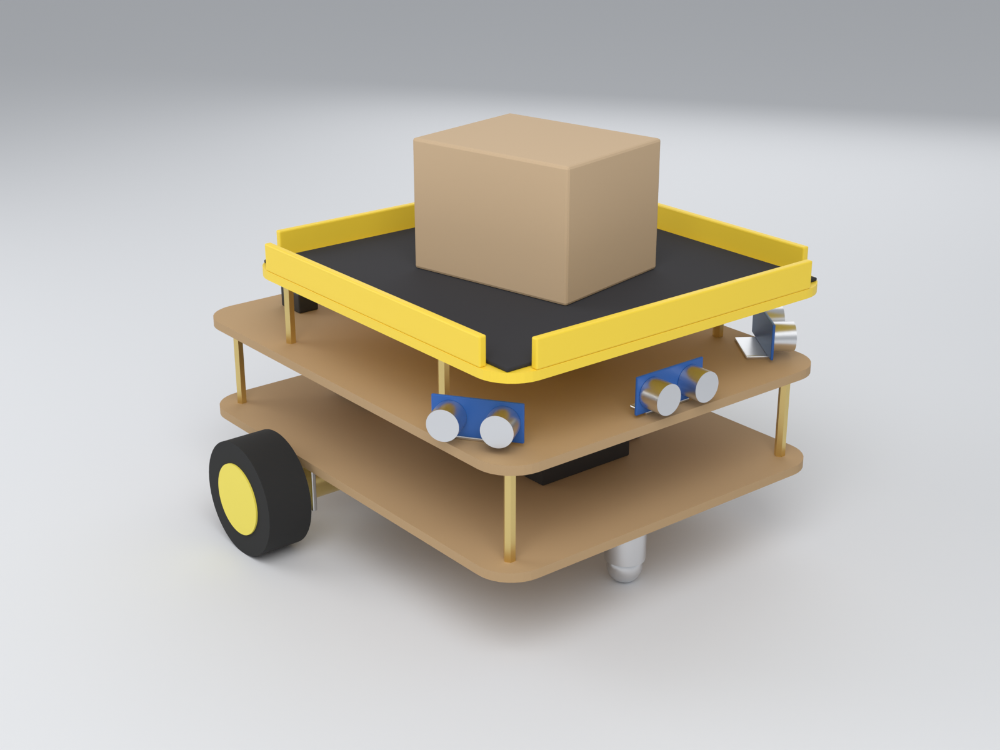

# LittleCheeseWorks: robot autónomo de transporte de carga

Robot móvil de bajo costo que lleva objetos desde una base hasta un punto elegido en una app móvil.
Proyecto de la Universidad Autónoma de Occidente.

| Qué | Dónde |
|---|---|
| Especificaciones del proyecto | [`docs/especificaciones.md`](docs/especificaciones.md) |
| Presupuesto con enlaces de compra y reparto entre 4 | [`docs/presupuesto.md`](docs/presupuesto.md) |
| Tutorial de armado y conexión del ESP32 | [`docs/tutorial_conexion.md`](docs/tutorial_conexion.md) |
| **Versión de clase: robot mini para 2 × 2 m (~$215 por persona)** | [`docs/robot_mini_2x2.md`](docs/robot_mini_2x2.md) |
| Modelo 3D del prototipo (Blender) | [`docs/modelo/`](docs/modelo/) |
| App Flutter (Android, iOS, escritorio, web) | [`app/`](app/) |
| Sketches para comprobar el cableado | [`firmware/prueba_conexiones/`](firmware/prueba_conexiones/) (robot grande) · [`firmware/prueba_mini/`](firmware/prueba_mini/) (robot mini) |

**Estado:** la app funciona con el robot simulado. El firmware del robot (navegación y servidor WebSocket) está pendiente; `firmware/` solo contiene el sketch de prueba de conexiones.
