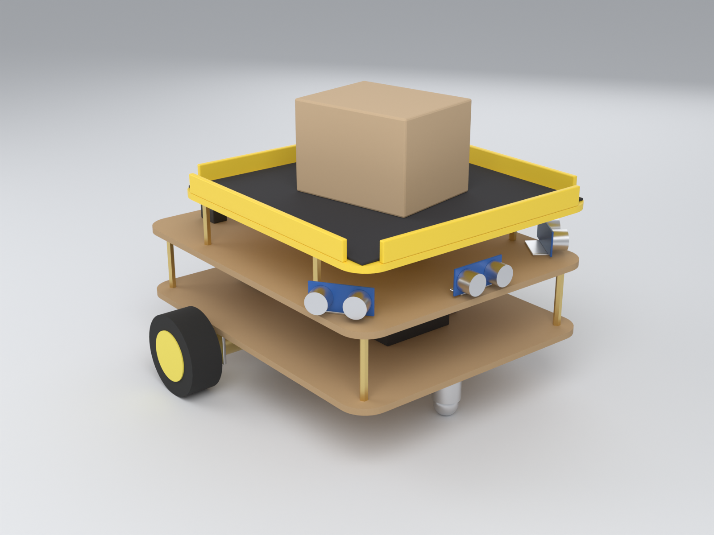

# Robot Autónomo de Transporte de Carga con Control Móvil
## Documento de Especificaciones del Proyecto

**Institución:** Universidad Autónoma de Occidente
**Integrantes:** Ali Avila Ebrahim Alejandro; Molina Garcia Jesus Armando; Estavillo Servin Xavier; Ayala Noriega Rey David
**Versión:** 0.3 (borrador) — se agregan presupuesto con enlaces de compra, tutorial de conexión y prototipo 3D

**Documentos relacionados:** [Presupuesto y enlaces de compra](presupuesto.md) · [Tutorial de armado y conexión](tutorial_conexion.md) · [Modelo 3D](modelo/robot_prototipo.blend) · [Versión reducida para 2 × 2 m](robot_mini_2x2.md)

---

## 1. Introducción

### 1.1 Objetivo
Diseñar y construir un robot móvil de bajo costo que transporte objetos desde un punto de partida (la base) hasta un punto elegido por el usuario dentro de un cuarto, detectando objetos y obstáculos en el camino, controlado mediante una aplicación móvil multiplataforma (Android e iOS) que incluye un mapa 2D, un visor 3D y un modo de simulación para pruebas sin hardware.

### 1.2 Alcance
- Robot móvil diferencial con bandeja de carga.
- Localización relativa a la base: al colocar el objeto en la base y calibrar, el robot fija ese punto como origen (0,0) y calcula su posición por odometría.
- Navegación a coordenadas elegidas en el mapa de la app, con detención ante obstáculos.
- Detección de objetos con sensores y registro de su posición en el mapa.
- App móvil: mapa 2D del cuarto, visor 3D, envío a un punto, estado en tiempo real y alertas.
- Simulador integrado en la app para pruebas locales.
- Presupuesto máximo: **300 USD**. Plazo: **un semestre (~16 semanas)**.

### 1.3 Fuera de alcance
- SLAM/LiDAR ni mapeo automático del cuarto (el cuarto se define en la app).
- Reconocimiento de personas o voz; clasificación de objetos por visión.
- Evasión de obstáculos con replaneación de ruta (solo detenerse y reanudar).
- Operación en exteriores o pisos irregulares.

### 1.4 Glosario
| Término | Definición |
|---|---|
| Base | Punto de partida del robot; su posición es el origen (0,0) del mapa |
| Calibrar | Acción de confirmar que el objeto está en la base; fija el origen |
| Destino | Coordenada (x, y) en metros elegida en el mapa |
| Odometría | Estimación de posición a partir de encoders (y opcionalmente IMU) |
| PID | Controlador proporcional-integral-derivativo |
| BOM | Lista de materiales (Bill of Materials) |

---

## 2. Requisitos

### 2.1 Casos de uso
| ID | Caso de uso | Actor | Descripción |
|---|---|---|---|
| CU-01 | Calibrar en la base | Operador | Coloca el objeto en la bandeja en la base y pulsa Calibrar; el robot fija su origen |
| CU-02 | Llevar carga a un punto | Operador | Toca un punto del mapa (o elige uno guardado) y pulsa "Llevar aquí" |
| CU-03 | Confirmar retiro de carga | Receptor | Retira el objeto en el destino y pulsa "Ya retiré la carga"; el robot regresa a la base |
| CU-04 | Detener en emergencia | Cualquiera | Detiene el robot desde la app o con el botón físico |
| CU-05 | Consultar detecciones | Operador | Ve en el mapa/visor 3D los objetos detectados y el historial de alertas |
| CU-06 | Probar en simulación | Desarrollador | Usa el robot simulado y coloca objetos en el cuarto virtual |

### 2.2 Requisitos funcionales
| ID | Requisito | Criterio de aceptación |
|---|---|---|
| RF-01 | Al calibrar, el robot fijará su posición actual como origen (0,0) | Estado pasa a LISTO con posición (0,0) |
| RF-02 | El robot navegará hasta las coordenadas indicadas | Llega a ≤ 10 cm del destino en ≥ 9 de 10 intentos |
| RF-03 | El robot detectará objetos al frente y se detendrá | Se detiene a ≥ 10 cm de un obstáculo a velocidad nominal |
| RF-04 | El robot reanudará la marcha al despejarse el obstáculo | Reanuda en ≤ 3 s tras retirarlo |
| RF-05 | La app permitirá elegir el destino tocando el mapa o un punto guardado | Comando recibido por el robot en ≤ 2 s |
| RF-06 | La app mostrará posición y estado del robot en tiempo real (mapa 2D y visor 3D) | Actualización cada ≤ 1 s |
| RF-07 | El robot esperará el retiro de la carga en el destino | Permanece detenido hasta confirmación o tiempo límite (60 s) |
| RF-08 | El robot regresará a la base tras la entrega | Regresa a ≤ 10 cm de (0,0) en ≥ 9 de 10 intentos |
| RF-09 | Parada de emergencia desde la app y botón físico | Motores detenidos en ≤ 500 ms |
| RF-10 | El robot reportará objetos detectados con posición aproximada | Evento recibido en la app en ≤ 1 s tras la detección |
| RF-11 | La app notificará fallas (batería baja, obstáculo prolongado > 30 s, ubicación perdida, conexión perdida) | Notificación en ≤ 3 s |

### 2.3 Requisitos no funcionales
| ID | Requisito | Valor objetivo |
|---|---|---|
| RNF-01 | Carga útil | ≥ 1.5 kg |
| RNF-02 | Velocidad nominal | 0.2–0.5 m/s |
| RNF-03 | Autonomía | ≥ 2 h de uso continuo |
| RNF-04 | Estabilidad | No volcar ni deslizar la carga en aceleración/frenado normales |
| RNF-05 | Costo total | ≤ 300 USD |
| RNF-06 | Compatibilidad app | Android 10+ e iOS 14+ (y escritorio/web para pruebas) |
| RNF-07 | Seguridad | Sin bordes cortantes; tensión de operación ≤ 12 V |
| RNF-08 | Precisión de posición | Error ≤ 10 cm tras un recorrido de 5 m |

---

## 3. Hardware y electrónica

### 3.1 Arquitectura general
```
 Batería ─► Regulación 5V/3.3V ─► ESP32 ◄─► Sensores (ultrasonido, encoders, IMU)
    │                               │
    └────► Driver motores ◄─────────┘
                │
          2 motores DC con encoders
```

### 3.2 Componentes principales
| Subsistema | Componente sugerido | Función |
|---|---|---|
| Controlador | ESP32 DevKit V1 (30 pines) | Lógica, control y WiFi/BLE |
| Tracción | 2 motorreductores GM25-370 de 12 V y 140 RPM con **encoder** Hall (11 PPR × 45:1) + llantas de 65 mm + rueda loca | Movimiento diferencial y odometría |
| Driver | TB6612FNG (1.2 A continuos por canal; el motor pide ≤ 0.8 A nominal y ≤ 2 A bloqueado) | Control de motores |
| Orientación | IMU MPU6050 (giroscopio) | Corregir el rumbo en la odometría |
| Detección | 3 × HC-SR04P (versión de 3.3 V): frontal + 2 laterales a ~55° | Detección de objetos y obstáculos |
| Energía | Paquete Li-ion 3S (11.1 V, 2200 mAh) con BMS integrado + convertidor buck LM2596 a 5 V | Alimentación |
| Seguridad | Botón de paro de emergencia con contacto NC en serie con la alimentación de los motores | RF-09 |
| Estructura | Dos placas de MDF de 28 × 22 cm sobre separadores M3 de 50 mm + bandeja de 22 × 22 cm con borde y tapete antideslizante | Soporte y carga |
| Indicadores | LED bicolor rojo-verde + buzzer | Estado local |

Asignación de pines, diagrama de energía y pasos de armado: ver [`tutorial_conexion.md`](tutorial_conexion.md).

### 3.2.1 Prototipo


Modelo 3D en [`modelo/robot_prototipo.blend`](modelo/robot_prototipo.blend); se regenera con `blender -b -P docs/modelo/generar_prototipo.py`. Más vistas en el tutorial.

> **Cambio respecto a v0.1:** el seguidor de línea (array IR) se elimina; para navegar a coordenadas libres se requieren encoders e IMU. **A confirmar con el equipo y el profesor.**

### 3.3 Lista de materiales (BOM) y presupuesto
El detalle pieza por pieza, con enlaces de compra y reparto entre los integrantes, está en [`presupuesto.md`](presupuesto.md). Precios en pesos mexicanos al 11 de noviembre de 2026.

| Grupo | Plan A (el más barato) | Plan B (todo nacional) |
|---|---|---|
| Electrónica, batería y cargador (UNIT Electronics, precios verificados) | $1,050 | $1,050 |
| Tracción y paro de emergencia | $249 (AliExpress) | $656–816 (motores UNIT + piezas estimadas) |
| Chasis, tornillería y cableado (compra local, estimado) | $300 | $300 |
| Envío (estimado) | $150 | $150 |
| Imprevistos (10 %) | $175 | $216–232 |
| **Total** | **$1,924** | **$2,372–2,548** |
| **Por persona (4 integrantes)** | **$481** | **$593–637** |

Para una clase existe además una **versión reducida (robot mini para un cuarto de 2 × 2 m)** de unos $860 en total, $215 por persona, que no cumple los requisitos de carga, autonomía ni precisión: ver [`robot_mini_2x2.md`](robot_mini_2x2.md).

Ambos planes quedan por debajo del tope de 300 USD (RNF-05): entre 96 y 150 USD con un tipo de cambio de 17 a 20 pesos por dólar.

### 3.4 Consideraciones de diseño
- Centro de gravedad bajo; bandeja con borde y superficie antideslizante.
- Rampas suaves de aceleración y frenado.
- Calibración de encoders y del rumbo; el error de odometría crece con la distancia (ver RNF-08).
- Filtrado de sensores y diodo de protección contra picos de los motores.

---

## 4. Software y arquitectura

### 4.1 Arquitectura de componentes
```
 App Flutter (Android/iOS/escritorio/web)
   ├─ Mapa 2D · Visor 3D · Estado · Alertas
   └─ RobotService (interfaz)
        ├─ SimulatedRobotService   (pruebas locales)
        └─ WebSocketRobotService ──WiFi──► ESP32 (firmware)
                                            ├─ Comunicación
                                            ├─ Máquina de estados
                                            ├─ Odometría + control de movimiento
                                            └─ Sensores y motores
```
ESP32 en modo servidor WebSocket (puerto 81) sobre una red WiFi local o punto de acceso propio.

### 4.2 Máquina de estados del robot
| Estado | Descripción | Transiciones |
|---|---|---|
| ESPERANDO_CARGA | En la base, sin carga o sin calibrar | `calibrate` → LISTO; `goto` → EN_RUTA (si ya está calibrado) |
| LISTO | Calibrado y con carga, esperando destino | `goto` → EN_RUTA (`goto` se acepta en cualquier estado sin falla mientras el robot esté calibrado, para cambiar el destino sin pararlo) |
| EN_RUTA | Avanza hacia el destino | Obstáculo → OBSTACULO; llega → ENTREGANDO; ubicación perdida → ERROR |
| OBSTACULO | Detenido por objeto | Despejado → estado previo; > 30 s → ERROR |
| ENTREGANDO | En destino, espera retiro de la carga | `unload` o timeout 60 s → REGRESANDO; `goto` → EN_RUTA (nuevo destino) |
| REGRESANDO | Vuelve a (0,0) | Llega → ESPERANDO_CARGA; obstáculo → OBSTACULO |
| ERROR / PARO | Falla o emergencia | `reset` → LISTO (si sigue calibrado) o ESPERANDO_CARGA |

### 4.3 Protocolo de mensajes (JSON)
```json
// App → Robot
{"cmd": "calibrate"}
{"cmd": "goto", "x": 2.5, "y": 1.0}
{"cmd": "unload"}
{"cmd": "stop"}
{"cmd": "reset"}

// Robot → App (estado, periódico ≤ 1 s)
{"state": "EN_RUTA", "x": 1.2, "y": 0.4, "heading": 0.35, "load": true,
 "calibrated": true, "target": {"x": 2.5, "y": 1.0}, "battery": 78, "obstacle": false}

// Robot → App (eventos)
{"event": "object", "id": 3, "x": 1.8, "y": 0.9, "w": 0.3, "h": 0.3}
{"event": "object_gone", "id": 3}
{"event": "error", "code": "LOCALIZATION_LOST"}
```
Coordenadas en metros respecto a la base; +x a la derecha y +y hacia abajo en la vista superior; `heading` en radianes. Códigos de error: `LOCALIZATION_LOST`, `LOW_BATTERY`, `OBSTACLE_TIMEOUT`.

### 4.4 Aplicación móvil (Flutter)
Pestañas: (1) **Preparar**: conexión (IP del ESP32 o modo simulación) y calibración en la base; (2) **Mapa**: plano 2D del cuarto, robot, objetos detectados, destino y puntos guardados; (3) **3D**: visor orbitable del cuarto, robot, carga y objetos; (4) **Estado**: estado, posición, batería, retiro de carga; (5) **Alertas**: historial. Botón de **PARO** siempre visible.
Capas: UI → estado (Riverpod) → servicio de comunicación (`RobotService`).
Las medidas del cuarto y la posición de la base se definen en la pestaña Preparar; la app guarda el cuarto, los puntos y la IP del robot entre sesiones.
Si se pierde la conexión con el robot real, la app lo indica y reintenta sola hasta recuperarla.
El mapa dibuja el recorrido hecho por el robot desde que salió de la base.
El visor 3D es un renderizador propio en Dart (cámara orbital con perspectiva), sin dependencias nativas.

### 4.5 Firmware
- Plataforma: Arduino framework / PlatformIO sobre ESP32.
- Lazo de control a 100 Hz; odometría con encoders + giroscopio; control de rumbo y velocidad hacia el punto destino.
- Ultrasonido a 20 Hz con filtro de mediana; asociación simple de lecturas a objetos (id, posición).
- *Watchdog* y detención de motores si se pierde la comunicación.

---

## 5. Plan de pruebas

### 5.1 Niveles
1. **Unitarias**: parser de mensajes, simulador, proyección 3D (automatizadas en `app/test`).
2. **Integración**: motores + encoders + sensores + comunicación.
3. **Sistema/campo**: recorridos completos en un cuarto marcado.

### 5.2 Casos de prueba
| ID | Prueba | RF | Resultado esperado |
|---|---|---|---|
| PR-01 | Calibrar en la base | RF-01 | Posición (0,0), estado LISTO |
| PR-02 | Ir a un punto en línea recta y con giro | RF-02 | Llega a ≤ 10 cm |
| PR-03 | Objeto a 30 cm en la trayectoria | RF-03 | Se detiene ≥ 10 cm |
| PR-04 | Retirar el objeto | RF-04 | Reanuda en ≤ 3 s |
| PR-05 | Enviar desde el mapa / punto guardado | RF-05 | Comando recibido en ≤ 2 s |
| PR-06 | Latencia de estado en mapa y 3D | RF-06 | ≤ 1 s |
| PR-07 | Esperar y confirmar retiro de carga | RF-07 | Regresa tras confirmar o a los 60 s |
| PR-08 | Regreso a la base | RF-08 | Termina en ESPERANDO_CARGA a ≤ 10 cm de (0,0) |
| PR-09 | Paro de emergencia (app y botón) | RF-09 | Motores off ≤ 500 ms |
| PR-10 | Detección de objetos fuera de la trayectoria | RF-10 | Aparecen en el mapa con error ≤ 15 cm |
| PR-11 | Alertas (batería, obstáculo > 30 s, conexión) | RF-11 | Notificación ≤ 3 s |
| PR-12 | Carga de 1.5 kg | RNF-01/04 | Sin desplazarse ni caer |
| PR-13 | Autonomía | RNF-03 | ≥ 2 h |
| PR-14 | Error de odometría tras 5 m | RNF-08 | ≤ 10 cm |
| PR-15 | Pérdida de WiFi | RF-09 | Se detiene de forma segura |

### 5.3 Métricas de éxito
Tasa de entrega correcta ≥ 90 %, cero colisiones en 20 recorridos, latencia de comandos ≤ 2 s.

---

## 6. Plan de proyecto

### 6.1 Cronograma (16 semanas)
| Semanas | Actividad | Hito |
|---|---|---|
| 1–2 | Requisitos, diseño, compra de materiales | Documento de specs aprobado |
| 3–5 | Ensamble del chasis y electrónica | Robot se mueve |
| 6–8 | Odometría, control de movimiento a coordenadas y detección de obstáculos | Va a un punto |
| 9–11 | Comunicación y app Flutter (mapa, 3D, simulador) | App controla robot |
| 12–13 | Integración y máquina de estados completa | Entrega de punta a punta |
| 14–15 | Pruebas de campo y ajustes | Informe de pruebas |
| 16 | Documentación final y presentación | Entrega |

### 6.2 Riesgos
| Riesgo | Prob. | Impacto | Mitigación |
|---|---|---|---|
| Deriva de la odometría | Alta | Alto | Encoders de calidad, IMU, regreso a la base para recalibrar |
| Carga que se desliza o cae | Media | Alto | Rampas de aceleración, bandeja con borde |
| WiFi inestable | Media | Alto | Punto de acceso propio, fallback BLE |
| Detección poco fiable (ultrasonido) | Media | Medio | Filtro de mediana, sensores laterales, ToF |
| Retraso en compras | Media | Medio | Pedir en semana 1, proveedores locales |
| Presupuesto excedido | Baja | Medio | Margen amplio respecto al tope (ver presupuesto.md), componentes genéricos |
| Inexperiencia con Flutter | Media | Medio | Prototipo con simulador desde temprano |

### 6.3 Roles sugeridos
Líder de proyecto, responsable de hardware, responsable de firmware, responsable de app, responsable de pruebas y documentación.

---

## 7. Anexos
- A. Conexiones: tabla de pines y diagrama de energía en [`tutorial_conexion.md`](tutorial_conexion.md) (esquemático formal pendiente)
- B. Prototipo 3D: [`modelo/robot_prototipo.blend`](modelo/robot_prototipo.blend) e imágenes en `img/` (planos de corte del chasis pendientes)
- C. Bitácora de pruebas (pendiente)
- D. Referencias
- E. Presupuesto detallado con enlaces de compra: [`presupuesto.md`](presupuesto.md)
