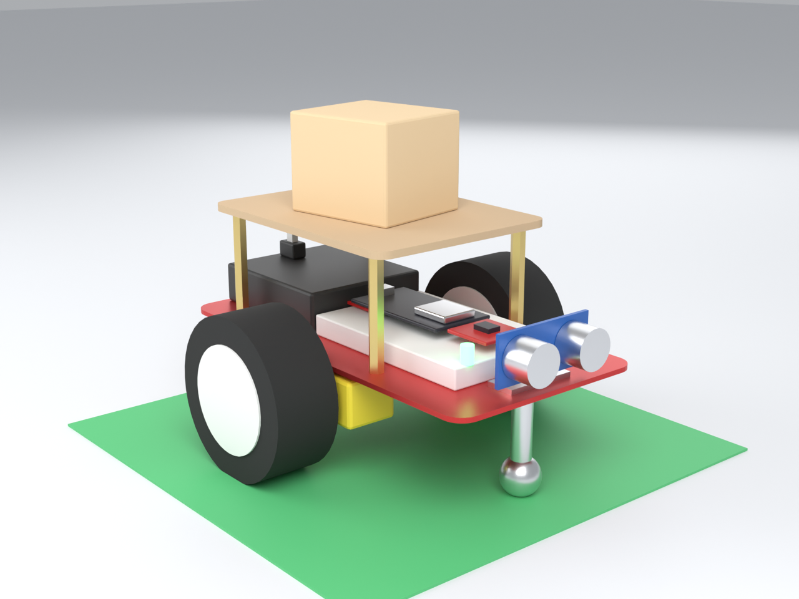
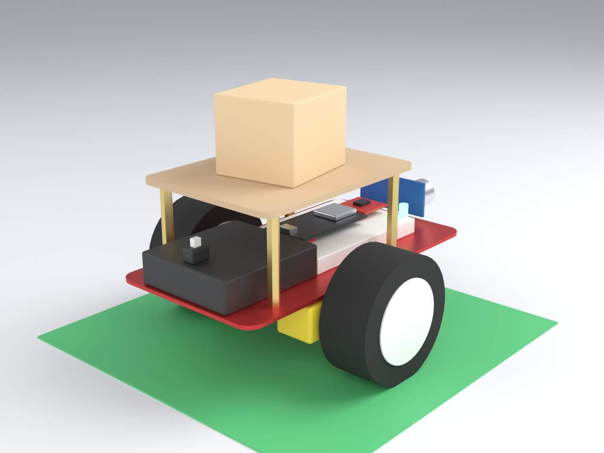
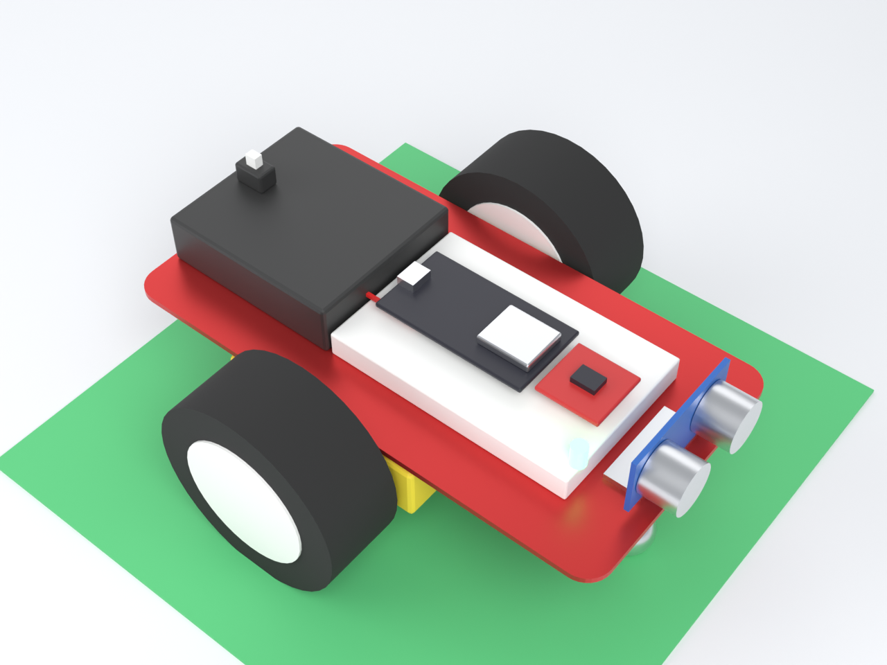
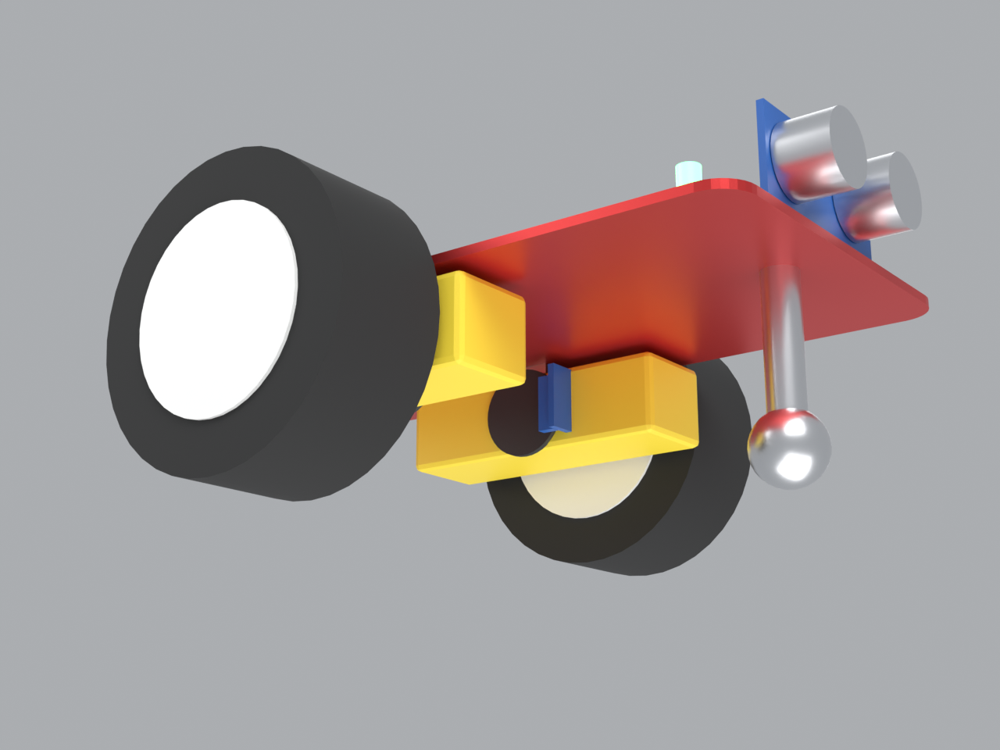

# Robot mini para un cuarto de 2 × 2 m (versión de clase)

Versión reducida del proyecto: mismo flujo (calibrar en la base, elegir un punto en el mapa, llevar la carga, esperar el retiro, regresar) y la misma app, pero con un robot chico, pocas piezas y **todo de UNIT Electronics**.

- Presupuesto de esta versión: **$860 en total, unos $215 por persona** (con sensores de rueda; $807 y $202 sin ellos).
- El robot grande (con encoders de motor, IMU y batería 3S) sigue documentado en [`presupuesto.md`](presupuesto.md) y [`tutorial_conexion.md`](tutorial_conexion.md): $481 por persona en su opción más barata.

> **Alcance honesto.** Esta guía no está probada con el hardware: los precios son los del catálogo de UNIT del 11 de noviembre de 2026, pero la compatibilidad entre piezas (marcada con ⚠) hay que confirmarla al recibirlas. El firmware del robot sigue sin existir; solo se incluye un sketch para comprobar el cableado.

## Cómo se ve



Es una ilustración 3D hecha con las medidas de las fichas de UNIT (chasis de 170 × 90 mm, llantas de 65 mm). El kit real puede variar en la forma del chasis y de los soportes de motor. El cuadro verde es la base (el origen del mapa).

| Vista trasera: portapilas con interruptor | Sin la bandeja: ESP32, driver y ultrasónico |
|---|---|
|  |  |



Desde abajo se ven los motorreductores amarillos, el disco encoder en el extremo interior del eje y su sensor de ranura (azul). Es la parte que hay que confirmar con el kit real (ver sección 3).

El modelo editable está en [`modelo/robot_mini.blend`](modelo/robot_mini.blend) y se regenera con `blender -b -P docs/modelo/generar_robot_mini.py`.

---

## 1. Qué cambia respecto al proyecto completo

| Tema | Proyecto completo | Robot mini 2 × 2 |
|---|---|---|
| Cuarto | 6 × 4 m | **2 × 2 m**, base en una esquina a 25 cm de cada pared |
| Chasis y motores | MDF a la medida + 2 motores 12 V con encoder | **Kit de chasis 2WD de aluminio** con 2 motorreductores, 2 llantas y rueda loca |
| Posición | Encoders de motor (≈ 1980 cuentas por vuelta) + IMU | **Sensor de rueda por ranura** (≈ 20 pulsos por vuelta), sin IMU |
| Obstáculos | 3 ultrasónicos | **1 ultrasónico** al frente |
| Energía | Batería 3S 11.1 V con BMS + buck | **4 pilas AA** (6 V) con portapilas e interruptor |
| Paro de emergencia | Botón de hongo que corta los motores | **El interruptor del portapilas** (corta todo) y el botón PARO de la app |
| Carga | 1.5 kg | **Un objeto ligero, unos 200–300 g** (⚠ no probado) |
| Autonomía | ≥ 2 h | Una demostración de una o dos horas |
| Precisión | ≤ 10 cm | **Sin garantía**: esperar de 5 a 10 cm en recorridos de 2 m y corregir recalibrando en la base |
| Precio por persona | $481 | **~$215** |

Los requisitos RNF-01 (carga), RNF-03 (autonomía) y RNF-08 (precisión) de [`especificaciones.md`](especificaciones.md) **no se cumplen** en esta versión; si la clase los exige, hay que quedarse con el robot grande.

---

## 2. Lista de compras (todo UNIT Electronics, precios verificados)

| # | Pieza | Cant. | Unitario | Subtotal | Enlace |
|---|---|---|---|---|---|
| 1 | Kit chasis de aluminio 2WD (rojo; el azul cuesta $278): chasis, 2 motorreductores 1:48 de 200 RPM, 2 llantas, rueda loca y tornillos | 1 | $223 | $223 | [uelectronics.com](https://uelectronics.com/producto/kit-chasis-de-aluminio-para-robot-movil/) |
| 2 | ESP32 DevKit V1 30 pines, versión USB-C | 1 | $133 | $133 | [uelectronics.com](https://uelectronics.com/producto/esp32-devkit-v1-30-pines-usb-c-microusb/) |
| 3 | Driver doble puente H TB6612FNG | 1 | $54 | $54 | [uelectronics.com](https://uelectronics.com/producto/doble-puente-h-tb6612fng/) |
| 4 | Sensor ultrasónico HC-SR04P (3–5 V) | 1 | $32 | $32 | [uelectronics.com](https://uelectronics.com/producto/hc-sr04p-sensor-ultrasonico-3-5v/) |
| 5 | Soporte para sensor HC-SR04 | 1 | $12 | $12 | [uelectronics.com](https://uelectronics.com/producto/soporte-para-sensor-ultrasonico-hc-sr04/) |
| 6 | Portapilas AA con tapa e interruptor ON/OFF, variante **4 pilas** | 1 | $13 | $13 | [uelectronics.com](https://uelectronics.com/producto/porta-pilas-aa-con-tapa-y-interruptor-on-off/) |
| 7 | Paquete de 4 pilas alcalinas AA | 1 | $49 | $49 | [uelectronics.com](https://uelectronics.com/producto/paquete-de-4-pilas-alcalinas-aa-bat-aa4/) |
| 8 | Sensor de velocidad F249 (3.3–5 V), de ranura | 2 | $21 | $42 | [uelectronics.com](https://uelectronics.com/producto/sensor-de-velocidad-f249-3-3v-5v/) |
| 9 | Disco encoder para sensor de velocidad | 2 | $3 | $6 | [uelectronics.com](https://uelectronics.com/producto/disco-encoder-para-sensor-de-velocidad/) |
| 10 | LED bicolor rojo-verde de cátodo común | 1 | $3 | $3 | [uelectronics.com](https://uelectronics.com/producto/led-bicolor-catodo-comun/) |
| 11 | Protoboard de 400 puntos | 1 | $18 | $18 | [uelectronics.com](https://uelectronics.com/producto/protoboard-de-400pts-y-830pts-blanco-o-transparente/) |
| 12 | Cables dupont de 30 cm (hembra-hembra, macho-hembra, macho-macho) | 1 | $26 | $26 | [uelectronics.com](https://uelectronics.com/producto/cables-dupont-extra-largos-30cm-hh-mh-mm/) |
| 13 | Cables dupont hembra-hembra | 1 | $17 | $17 | [uelectronics.com](https://uelectronics.com/producto/cable-dupont-hembra-hembra/) |
| 14 | Resistencias 1/4 W: 2 × 10 kΩ y 2 × 220 Ω | 4 | ~$1 | $4 *(estimado)* | [buscar en UNIT](https://uelectronics.com/?s=resistencia+1%2F4&post_type=product) |
| | **Subtotal de piezas** | | | **$632** | |

Los renglones 6 (variante 4 pilas), 11, 12 y 13 usan el precio de la variante o del extremo alto del rango publicado; el 14 es estimado.

### Total y reparto

| Concepto | Con sensores de rueda | Sin sensores de rueda (renglones 8 y 9) |
|---|---|---|
| Piezas | $632 | $584 |
| Envío de UNIT (estimado; confirmar en el carrito, puede ser gratis pasado un mínimo) | $150 | $150 |
| Imprevistos (10 %) | $78 | $73 |
| **Total** | **$860** | **$807** |
| **Por persona (÷ 4)** | **$215** | **$202** |

Sin sensores de rueda el robot solo puede ir **por tiempo de marcha**: la posición se desvía mucho más y `RF-02` queda fuera. Los $48 que cuestan los sensores valen la pena.

Aparte, y sin costo: una base de cartón para la carga, cinta doble cara, y una **batería externa (power bank) USB** si alguien tiene una (ver el paso de energía).

### Si hay que gastar menos todavía
- Compartir el envío con otro equipo, o comprar en tienda física si UNIT tiene sucursal cercana.
- Usar un cable USB y un power bank que ya se tengan para el ESP32 y dejar las pilas solo para los motores.
- No se recomienda quitar el TB6612FNG por un L298N: pierde unos 2 V en calor y con 6 V se nota.

---

## 3. ⚠ Cosas que hay que confirmar antes de comprar o al recibir las piezas

1. **Voltaje de los motores del kit.** La ficha de UNIT dice 200 RPM y relación 1:48, pero **no indica el voltaje**. Los motorreductores de este tipo suelen trabajar de 3 a 6 V; con 4 pilas (6 V) deberían ir bien. Pregúntalo a UNIT o míralo en la etiqueta del motor.
2. **Eje doble en los motores.** El disco encoder va en el segundo extremo del eje, y la ficha no dice si el motor lo trae. En las fotos del kit se ve si el motor tiene eje por los dos lados. **Si no lo tiene, no se puede montar el disco** y hay que usar el robot sin sensores de rueda.
3. **Ranuras del disco.** El disco no indica cuántas ranuras tiene (normalmente 20). Se cuentan a simple vista y ese dato va en el firmware.
4. **Una sola pista por rueda.** Cada sensor da una sola señal, así que el robot no sabe en qué sentido gira la rueda: lo deduce de lo que él mismo ordenó al motor. Funciona bien mientras la rueda no se arrastre.
5. **Pilas bajas.** Con las pilas casi agotadas (menos de 4.8 V) el ESP32 puede reiniciarse al arrancar los motores. Hay un aviso de batería baja en la prueba `b`.

---

## 4. Conexiones

Usa los **mismos pines que el robot grande** (así el firmware futuro es compartido) y solo los que aplican. Las reglas de seguridad de [`tutorial_conexion.md`](tutorial_conexion.md) (apagar antes de conectar, tierras unidas, 3.3 V en los pines) también valen aquí.

### Energía

```
4 pilas AA (6 V) ─► interruptor del portapilas ─► riel 6 V ─► TB6612 pin VM
                                                       └────► ESP32 pin VIN
                                                       └────► divisor 10 kΩ / 10 kΩ ─► GPIO35 (para medir la batería)
```

- El ESP32 acepta de 5 a 12 V en VIN: con 4 pilas nuevas (6.4 V) funciona, y se sigue encendiendo mientras las pilas den más de unos 4.5 V.
- **Alternativa más estable:** alimentar el ESP32 por su puerto USB con un power bank y dejar las pilas solo para los motores. Así los arranques de los motores no lo reinician. Une **las tierras (GND)** de las dos fuentes.
- Si el robot se reinicia al arrancar, pega un capacitor de 470 µF entre VM y GND del driver (se compra en cualquier tienda de electrónica; no está en la lista).

### Pines del ESP32

| Función | Pin | Va a |
|---|---|---|
| Alimentación | VIN, GND | Riel de 6 V y tierra común |
| 3.3 V | 3V3 | VCC del ultrasónico y de los sensores de rueda; VCC y STBY del driver |
| Motor izq. | GPIO25, GPIO26, GPIO27 | TB6612 PWMA, AIN1, AIN2 |
| Motor der. | GPIO13, GPIO32, GPIO33 | TB6612 PWMB, BIN1, BIN2 |
| Sensor de rueda izq. | GPIO18 | Salida (OUT/D0) del F249 izquierdo |
| Sensor de rueda der. | GPIO16 | Salida (OUT/D0) del F249 derecho |
| Ultrasónico frontal | TRIG GPIO23, ECHO GPIO36 | HC-SR04P |
| Voltaje de pilas | GPIO35 | Punto medio del divisor 10 kΩ / 10 kΩ (con 6.4 V llegan 3.2 V al pin) |
| LED rojo | GPIO14 | Pata del LED bicolor, con 220 Ω |
| LED verde | GPIO2 | La otra pata, con 220 Ω; la pata central a GND |

Del TB6612: VM al riel de 6 V, VCC y STBY a 3V3, los tres GND a tierra, AO1/AO2 al motor izquierdo y BO1/BO2 al derecho (si una rueda gira al revés, se intercambian sus dos cables). Los sensores F249 llevan VCC a 3V3, GND a tierra y OUT al pin de la tabla.

---

## 5. Armado

1. **Chasis.** Arma el kit según sus piezas: motores, llantas y rueda loca. Comprueba que el chasis quede horizontal.
2. **Discos.** Coloca un disco encoder en el extremo libre del eje de cada motor, y fija cada sensor F249 de modo que el disco pase por su ranura sin rozar (un soporte de cartón o un poco de cinta doble cara bastan).
3. **Ultrasónico.** Fíjalo al frente con su soporte, un poco arriba, sin que ni el chasis ni un cable le tapen la vista.
4. **Electrónica.** Pega el protoboard y el portapilas sobre el chasis. Monta el ESP32 y el driver en el protoboard o conéctalos con dupont.
5. **Revisión con el multímetro, todo apagado:** sin continuidad entre el riel de 6 V y GND ni entre 3V3 y GND, y ningún cable de 6 V toca un pin de señal del ESP32.
6. **Primer encendido.** Enciende el interruptor del portapilas y comprueba con el multímetro 3.3 V entre 3V3 y GND.

La **base** del robot es una esquina del cuarto: marca con cinta un cuadro de 20 × 20 cm a 25 cm de cada pared, que es el origen (0, 0) del mapa.

---

## 6. Prueba de conexiones

Sketch: [`../firmware/prueba_mini/prueba_mini.ino`](../firmware/prueba_mini/prueba_mini.ino). Se carga con Arduino IDE como se explica en el paso 7 de [`tutorial_conexion.md`](tutorial_conexion.md) (placa **ESP32 Dev Module**, Monitor Serie a 115200). Escribe la letra:

| Letra | Qué prueba | Resultado correcto |
|---|---|---|
| `u` | Ultrasónico | La distancia cambia al acercar la mano; `-1` = sin eco |
| `b` | Pilas | Alrededor de 6 V con pilas nuevas; avisa si bajan de 4.8 V |
| `l` | LED | Rojo y luego verde |
| `m` | Motores (**ruedas al aire**) | Cada rueda gira 1.5 s hacia adelante y cuenta pulsos |
| `r` | Sensores de rueda | Girando cada rueda a mano, su cuenta sube |
| `w` | WiFi | Aparece la red `RobotCarga` en el teléfono |

**El sketch no está compilado ni probado**: se escribió sin tener Arduino instalado. Si falla al compilar, copia el mensaje y se corrige.

---

## 7. Usar la app en el cuarto de 2 × 2 m

1. En la pestaña **Preparar**, toca la tarjeta **Cuarto** y pulsa el botón **Clase: 2 × 2 m**, luego **Guardar**. Pone el cuarto de 2 × 2 m con la base a 25 cm de las paredes izquierda y superior.
2. Con el robot en la esquina, el objeto sobre él y la app conectada, pulsa **Calibrar**.
3. En **Mapa**, toca un destino. En un cuarto de 2 × 2 m, los destinos útiles están a 1 o 1.5 m de la base.

El simulador de la app todavía usa distancias pensadas para el cuarto grande: el robot simulado frena a unos 50 cm de un objeto. En el robot real ese valor se ajusta en el firmware (10 a 15 cm es razonable en 2 × 2 m).

---

## 8. Pruebas mínimas para la clase

| Prueba | Qué se comprueba | Cómo |
|---|---|---|
| Ir a un punto | RF-02 | Enviar 1 m y medir el error con cinta; repetir 5 veces y anotar |
| Obstáculo | RF-03/04 | Poner una caja a 30 cm; debe detenerse y avanzar al quitarla |
| Entrega y regreso | RF-07/08 | Retirar la carga y ver que regresa a la base |
| Paro | RF-09 | Apagar con el interruptor del portapilas y con el botón PARO de la app |
| Pérdida de WiFi | RF-11 | Apagar el teléfono: el robot debe detenerse (requiere firmware) |

Anota los errores de posición medidos: sirven como resultado en el informe y para explicar por qué la versión completa usa encoders de motor e IMU.
