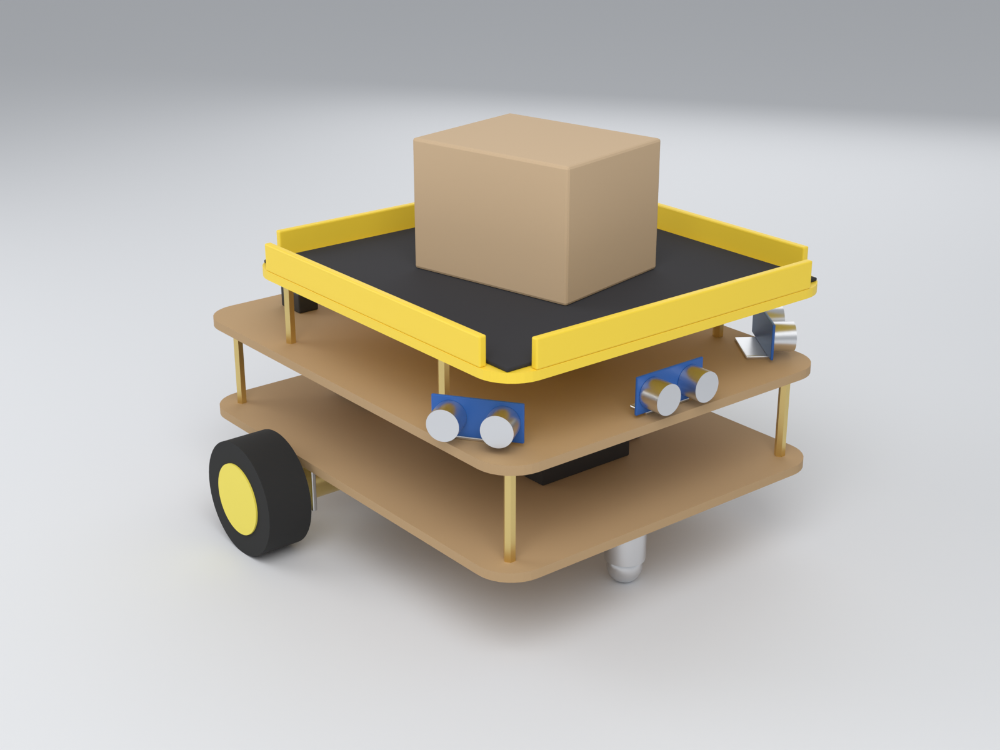
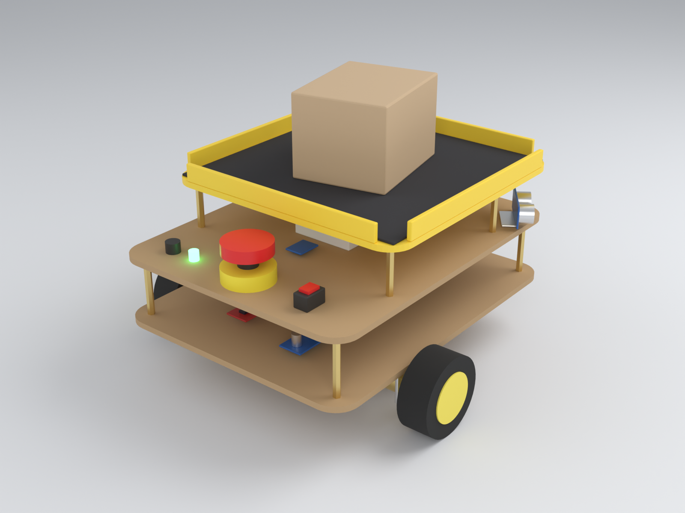
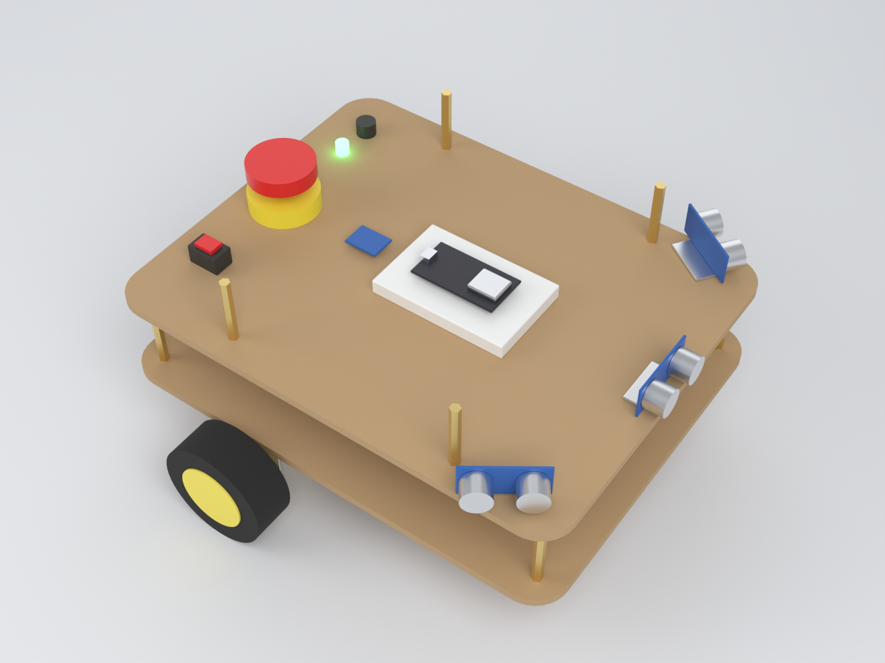
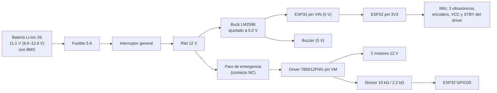

# Tutorial: armado y conexión del robot de carga

Guía paso a paso para armar el robot y conectar el ESP32. Sigue el orden: cada paso termina con una **comprobación**; no avances si falla.

- Lista de compras y costos: [`presupuesto.md`](presupuesto.md)
- Sketch para comprobar el cableado: [`../firmware/prueba_conexiones/prueba_conexiones.ino`](../firmware/prueba_conexiones/prueba_conexiones.ino)
- Modelo 3D editable: [`modelo/robot_prototipo.blend`](modelo/robot_prototipo.blend)

> **Alcance de esta guía.** Cubre el armado, el cableado y cómo comprobar que cada pieza funciona. El firmware del robot (navegación, máquina de estados y el servidor WebSocket que usa la app) **todavía no existe en el repositorio**; hasta que se escriba, la app solo funciona en *Modo simulación*.

---

## 1. Cómo es el robot

Tres niveles sobre separadores de latón M3:

| Nivel | Qué lleva | Por qué ahí |
|---|---|---|
| **Placa 1 (chasis)**, 28 × 22 cm | Motores, ruedas, rueda loca, batería, driver TB6612FNG, convertidor buck | Lo pesado va abajo: centro de gravedad bajo para que la carga no lo vuelque (RNF-04) |
| **Placa 2 (electrónica)**, 28 × 22 cm, 5 cm arriba | ESP32, IMU, 3 ultrasónicos, paro de emergencia, interruptor, LED y buzzer | Sensores con vista libre; paro e interruptor a la mano en la parte trasera |
| **Bandeja**, 22 × 22 cm, 4 cm arriba | Tapete antideslizante y borde de 1.5 cm | Es más corta que las placas para dejar libre el paro de emergencia |

Medidas clave: ruedas motrices de 65 mm a 5 cm detrás del centro, una a cada lado; rueda loca al frente; ultrasónico frontal al centro y los dos laterales en las esquinas delanteras, girados unos 55° hacia afuera. Alto total ≈ 16 cm sin carga.

---

## 2. Herramientas

Multímetro (**indispensable**), cautín y soldadura, pinzas de corte y de punta, desarmadores, llave Allen para los coples, taladro con brocas de 3 y 4 mm, cinta de aislar o termocontráctil, cinchos y cinta doble cara.

## 3. Reglas de seguridad

1. **Nunca conectes ni desconectes cables con la batería encendida.** Apaga el interruptor general primero.
2. **La batería de litio no se perfora, no se pone en corto y no se carga sin vigilancia.** Usa solo un cargador de 12.6 V para litio 3S. Si se hincha o se calienta, deja de usarla.
3. **Ajusta el convertidor buck a 5.0 V antes de conectarle el ESP32** (paso 5). Sale de fábrica con un voltaje cualquiera y puede quemar la placa.
4. **Al ESP32 solo le entran 3.3 V en sus pines.** Por eso los encoders y los ultrasónicos se alimentan con 3.3 V, no con 5 V.
5. **Todas las tierras (GND) van unidas**: batería, buck, ESP32, driver y sensores.
6. **Prueba los motores con las ruedas en el aire.**

---

## 4. Diagrama de energía

Puntos importantes:

- El **paro de emergencia corta físicamente la corriente de los motores** (va en serie entre el riel de 12 V y el pin VM del driver), sin depender del programa. El ESP32 sigue encendido y, gracias al divisor en GPIO35, se entera de que el paro está presionado (lee 0 V) y puede avisar a la app. Ese mismo pin mide el nivel de batería cuando el paro está suelto.
- Usa cable **calibre 22 AWG o más grueso** para todo lo que lleve 12 V y para los motores. Los cables dupont son solo para señales.
- Suelda un **capacitor electrolítico de 470 µF / 25 V** entre VM y GND, pegado al driver (pata larga a VM). Absorbe los picos de los motores que pueden reiniciar al ESP32.

---

## 5. Tabla de conexiones del ESP32 (DevKit V1, 30 pines)

| Función | Pin ESP32 | Va a | Notas |
|---|---|---|---|
| Alimentación | **VIN** | Salida + del buck (5.0 V) | |
| Tierra | **GND** | Tierra común | |
| 3.3 V | **3V3** | VCC de IMU, ultrasónicos, encoders; VCC y STBY del driver | Salida del ESP32, no le metas voltaje |
| IMU SDA | **GPIO21** | MPU6050 SDA | |
| IMU SCL | **GPIO22** | MPU6050 SCL | |
| Motor izq. velocidad | **GPIO25** | TB6612 PWMA | |
| Motor izq. dirección | **GPIO26**, **GPIO27** | TB6612 AIN1, AIN2 | |
| Motor der. velocidad | **GPIO13** | TB6612 PWMB | |
| Motor der. dirección | **GPIO32**, **GPIO33** | TB6612 BIN1, BIN2 | |
| Encoder izq. A / B | **GPIO18**, **GPIO19** | Cables amarillo / verde del motor izquierdo | |
| Encoder der. A / B | **GPIO16**, **GPIO17** | Cables amarillo / verde del motor derecho | En la placa están rotulados RX2 / TX2 |
| Ultrasónico frontal | TRIG **GPIO23**, ECHO **GPIO36** | HC-SR04P frontal | GPIO36 está rotulado VP |
| Ultrasónico izquierdo | TRIG **GPIO15**, ECHO **GPIO39** | HC-SR04P izquierdo | GPIO39 está rotulado VN |
| Ultrasónico derecho | TRIG **GPIO5**, ECHO **GPIO34** | HC-SR04P derecho | |
| Voltaje de motores | **GPIO35** | Punto medio del divisor 10 kΩ / 2.2 kΩ | Batería y estado del paro |
| Buzzer | **GPIO4** | Base del transistor 2N2222 (con 1 kΩ) | |
| LED rojo | **GPIO14** | Pata roja del LED bicolor (con 220 Ω) | |
| LED verde | **GPIO2** | Pata verde del LED bicolor (con 220 Ω) | También enciende el LED azul de la placa |

**Pines que no se usan a propósito:** GPIO12 (si queda en alto al encender, el ESP32 no arranca), GPIO1 y GPIO3 (son el USB con el que se programa) y GPIO6–11 (memoria interna). Por eso el indicador es un LED bicolor y no RGB: ya no hay pines seguros libres para un tercer color, y con rojo, verde y amarillo (ambos encendidos) alcanza para indicar el estado.

### Conexiones del driver TB6612FNG

| Pin del driver | Va a |
|---|---|
| VM | Salida del paro de emergencia (12 V) |
| VCC | 3V3 del ESP32 |
| GND (los tres) | Tierra común |
| STBY | 3V3 del ESP32 (driver siempre habilitado) |
| PWMA, AIN1, AIN2 | GPIO25, GPIO26, GPIO27 |
| AO1, AO2 | Motor izquierdo: cables **rojo** y **blanco** |
| PWMB, BIN1, BIN2 | GPIO13, GPIO32, GPIO33 |
| BO1, BO2 | Motor derecho: cables **rojo** y **blanco** |

### Cables de cada motor (GM25-370 con encoder, conector de 6 hilos)

| Color | Función | Va a |
|---|---|---|
| Rojo | Motor + | AO1 (izq.) o BO1 (der.) |
| Blanco | Motor − | AO2 (izq.) o BO2 (der.) |
| Azul | Alimentación del encoder | **3V3** (no 5 V) |
| Negro | Tierra del encoder | GND |
| Amarillo | Señal A | GPIO18 (izq.) o GPIO16 (der.) |
| Verde | Señal B | GPIO19 (izq.) o GPIO17 (der.) |

Los colores son los de la ficha del motor de UNIT Electronics; si compras el motor en otra tienda, confirma el orden en su ficha antes de conectar.

### Circuitos pequeños

- **Divisor de voltaje:** salida del paro (VM) → resistencia de **10 kΩ** → GPIO35 → resistencia de **2.2 kΩ** → GND. Con la batería llena (12.6 V) al pin le llegan 2.27 V.
- **Buzzer:** GPIO4 → resistencia de 1 kΩ → base del 2N2222; emisor a GND; colector al negativo del buzzer; positivo del buzzer a 5 V. El transistor evita que el buzzer le pida demasiada corriente al pin.
- **LED bicolor rojo-verde de cátodo común (3 patas):** pata central (cátodo) a GND; una pata lateral → 220 Ω → GPIO14 y la otra → 220 Ω → GPIO2. Si con la prueba `l` los colores salen intercambiados, cruza esos dos cables.
- **Ultrasónicos HC-SR04P:** VCC a 3V3, GND a tierra, TRIG y ECHO directo a sus pines. Si te llega el **HC-SR04 normal (solo 5 V)**, aliméntalo con 5 V y baja su ECHO con un divisor: ECHO → 1 kΩ → pin del ESP32 → 2 kΩ → GND.

---

## 6. Armado paso a paso

### Paso 1. Cortar las placas
Corta en MDF dos placas de 28 × 22 cm (5–6 mm la del chasis, 3 mm la de electrónica) y la bandeja de 22 × 22 cm (3 mm). Redondea las esquinas. Marca y taladra a 3 mm los agujeros de los separadores, a 1.5 cm de cada esquina; los dos separadores delanteros de la bandeja van 5 cm más atrás que la esquina, para **no quedar frente a los ultrasónicos laterales**.

### Paso 2. Montar la tracción
1. Atornilla los soportes de los motores bajo la placa 1, con los ejes alineados entre sí y a 5 cm detrás del centro.
2. Pon los coples hexagonales en los ejes (aprieta el prisionero sobre la cara plana del eje en "D") y atornilla las llantas.
3. Atornilla la rueda loca al frente. Calza con retazos de MDF hasta que **la placa quede horizontal**.

**Comprobación:** el robot rueda derecho al empujarlo y no cojea.

### Paso 3. Línea de 12 V
La batería trae un plug de 5.5 mm: enchúfala a un jack DC hembra fijo en la placa, para poder quitarla al cargar. Del jack: positivo → fusible de 5 A → interruptor general → bornera "12 V"; negativo → bornera "GND". Deja el interruptor **apagado**.

Confirma con el multímetro cuál terminal del jack es el positivo **antes** de conectar nada más. Para cargar, desenchufa la batería del robot y conéctala al cargador de 12.6 V.

**Comprobación:** enciende y mide entre 9 y 12.6 V en la bornera. Apaga.

### Paso 4. Paro de emergencia
Conecta un cable de la bornera de 12 V a un tornillo del contacto **NC** (normalmente cerrado) del paro y saca otro cable del otro tornillo: esa es la línea **VM**.

**Comprobación:** enciende; VM mide lo mismo que la batería con el botón suelto y 0 V al presionarlo. Apaga.

### Paso 5. Convertidor buck a 5.0 V
Conecta IN+ a 12 V e IN− a GND, **sin nada en la salida**. Enciende y gira el tornillo dorado del potenciómetro (suele ser hacia la izquierda, varias vueltas) hasta leer **5.0 V** en la salida. Pon una gota de barniz de uñas en el tornillo para que no se mueva. Apaga.

**Comprobación:** apaga y enciende de nuevo; sigue en 5.0 V (entre 4.9 y 5.1).

### Paso 6. ESP32
Monta el ESP32 en el protoboard y conecta la salida del buck: + a **VIN**, − a **GND**.

**Comprobación:** enciende; se prende el LED rojo de la placa y entre 3V3 y GND hay 3.3 V. Apaga.

### Paso 7. Driver y motores
Cablea el TB6612FNG según la tabla de arriba y suelda el capacitor de 470 µF entre VM y GND. Conecta los dos motores (rojo y blanco) a AO1/AO2 y BO1/BO2.

### Paso 8. Encoders
Azul a 3V3, negro a GND, amarillo y verde a sus pines.

### Paso 9. Sensores
1. **IMU:** atorníllala plana sobre la placa 2, centrada sobre el eje de las ruedas y lejos de los motores. VCC a 3V3, GND, SDA a GPIO21, SCL a GPIO22.
2. **Ultrasónicos:** uno al frente y dos en las esquinas delanteras, con sus soportes, a la misma altura y sin nada delante.
3. **Divisor de voltaje**, **buzzer** y **LED** según "Circuitos pequeños".

### Paso 10. Revisión antes de encender
Con el multímetro en continuidad y **todo apagado**:

- [ ] No hay continuidad entre 12 V y GND, ni entre 5 V y GND, ni entre 3V3 y GND.
- [ ] No hay continuidad entre 12 V y ningún pin del ESP32.
- [ ] Todas las tierras tienen continuidad entre sí.
- [ ] Ningún cable de 5 V llega a un pin de señal del ESP32.

---

## 7. Cargar el sketch de prueba

1. Instala **Arduino IDE 2**. En *Archivo → Preferencias → URLs adicionales de gestor de placas* pega `https://espressif.github.io/arduino-esp32/package_esp32_index.json`. En *Herramientas → Placa → Gestor de placas* instala **esp32 by Espressif Systems**.
2. Abre `firmware/prueba_conexiones/prueba_conexiones.ino`. Elige la placa **ESP32 Dev Module** (o *DOIT ESP32 DEVKIT V1*) y el puerto COM que aparece al conectar el USB.
3. Pulsa **Subir**. Si se queda en `Connecting...`, mantén presionado el botón **BOOT** de la placa hasta que empiece a cargar.
4. Abre el **Monitor Serie a 115200 baudios**.

Si el puerto COM no aparece, falta el controlador del chip USB: **CP2102** en la versión microUSB o **CH340** en la versión USB-C. También pasa con cables USB que solo cargan.

> Puedes programar por USB con la batería encendida solo si el buck ya está ajustado a 5.0 V. Ante la duda, apaga el interruptor general mientras programas.

### Pruebas (escribe la letra en el Monitor Serie)

| Letra | Qué prueba | Resultado correcto | Si falla |
|---|---|---|---|
| `i` | IMU | `Dispositivo en 0x68  <- MPU6050` | Revisa SDA/SCL (¿cruzados?), 3V3 y GND |
| `u` | Ultrasónicos | Tres distancias que cambian al acercar la mano a cada sensor | `-1` = sin eco: revisa TRIG/ECHO de ese sensor y su alimentación |
| `e` | Encoders | Al girar cada rueda hacia adelante su cuenta **sube**; una vuelta de rueda ≈ 1980 cuentas | Si baja, intercambia amarillo y verde. Si no cambia, revisa azul y negro |
| `b` | Batería y paro | Entre 9 y 12.6 V con el paro suelto; ≈ 0 V presionado | Revisa el divisor y que esté tomado **después** del paro |
| `l` | LED y buzzer | Rojo, verde y un pitido | LED al revés (cátodo a GND) o transistor mal orientado |
| `m` | Motores (**ruedas al aire**) | Cada rueda gira hacia adelante 1.5 s y dice `Encoder correcto` | Si gira hacia atrás, intercambia rojo y blanco de ese motor. El derecho casi siempre hay que invertirlo porque está montado en espejo |
| `w` | WiFi | En el teléfono aparece la red `RobotCarga` | Aleja la antena del ESP32 de metales y motores |

Repite `m` con el **paro presionado**: los motores no deben moverse y la prueba debe avisar que no hay voltaje.

---

## 8. Terminar el armado

1. Fija los cables con cinchos; ninguno debe rozar las ruedas ni tapar un sensor.
2. Monta la placa 2 sobre los separadores de 5 cm y la bandeja sobre los de 4 cm.
3. Pega el tapete antideslizante y el borde de la bandeja.
4. Pon 1.5 kg sobre la bandeja y repite la prueba `m` en el piso, con espacio libre.

## 9. Datos para el firmware

| Dato | Valor | Cómo afinarlo |
|---|---|---|
| Cuentas por vuelta de rueda | 11 × 45 × 4 = **1980** (motor de 140 RPM, tolerancia ±10 %) | Marca la llanta, dale 10 vueltas a mano y divide las cuentas entre 10 |
| Diámetro de rueda | ≈ 65–69 mm según la llanta | Haz avanzar el robot 2 m medidos con cinta y ajusta |
| Distancia entre ruedas | ≈ 25 cm (centro a centro) | Hazlo girar 10 vueltas sobre su eje y ajusta |
| Red WiFi | El ESP32 crea su propia red; su IP es `192.168.4.1` | Es la IP que la app trae por defecto |
| Protocolo con la app | WebSocket en el puerto 81 | Ver `especificaciones.md` §4.3 |

## 10. Problemas comunes

| Síntoma | Causa probable |
|---|---|
| El ESP32 se reinicia cuando arrancan los motores | Falta el capacitor de 470 µF, batería baja o cables de 12 V muy delgados |
| El ESP32 no arranca con todo conectado, pero sí por USB solo | Algún cable en GPIO12, o corto en 3V3 |
| No se puede programar con los sensores conectados | Algo mantiene GPIO2 en alto: revisa que el LED verde vaya a GND |
| El encoder cuenta "a saltos" | Encoder alimentado a 5 V o tierra floja |
| Un ultrasónico siempre da la misma distancia | Ve el piso, un separador o un cable: súbelo o gíralo |
| El robot se desvía en línea recta | Normal antes de calibrar; se corrige en el firmware con encoders + IMU |
| El buck se calienta mucho | Corto en 5 V o entrada y salida invertidas |
